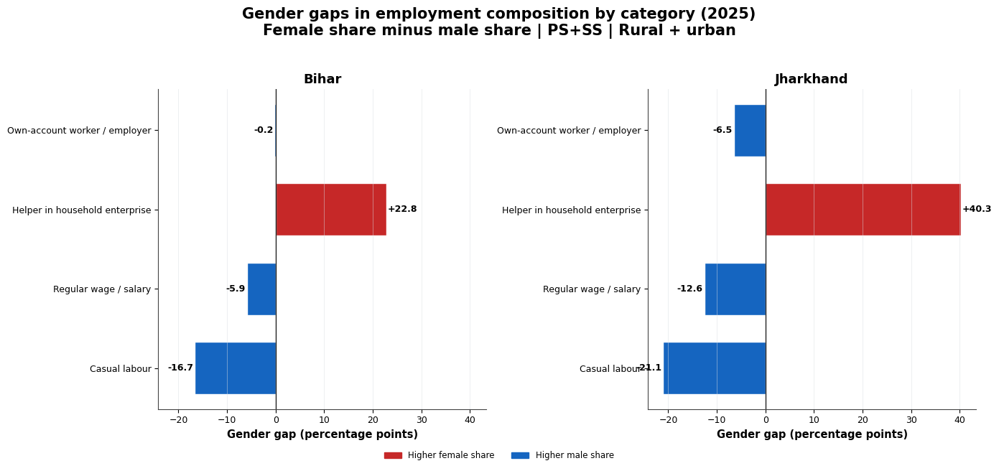

# Bihar and Jharkhand Employment Data Analysis

A comparative data analysis project exploring employment and gender-related patterns in Bihar and Jharkhand.

## Project Overview

This project uses data analysis and visualization to examine employment-related patterns across Bihar and Jharkhand. It focuses on comparing the two states and exploring differences in employment distribution, including gender-related patterns.

The project demonstrates how data analysis can help transform raw data into meaningful insights through data cleaning, exploratory analysis, statistical summaries, and visualizations.

## Objectives

- Explore employment-related data for Bihar and Jharkhand.
- Compare patterns between the two states.
- Examine gender-related differences in employment.
- Investigate how employment patterns vary across relevant categories.
- Present findings through tables and visualizations.

## Tools and Technologies

- **Python** for data analysis
- **Pandas** for data manipulation and cleaning
- **Matplotlib** for data visualization
- **Microsoft Excel** for working with tabular data
- **Visual Studio Code** for development
- **Git and GitHub** for version control and project documentation

## Methodology

The analysis follows these general steps:

1. **Data Preparation:** Load the dataset and prepare the relevant records for analysis.
2. **Data Cleaning:** Organize the data and address issues that may affect the analysis.
3. **Exploratory Data Analysis:** Examine employment patterns and relevant categories.
4. **Comparative Analysis:** Explore similarities and differences between Bihar and Jharkhand.
5. **Visualization:** Present selected findings through charts and figures.
6. **Output Generation:** Save the analysis results, tables, and visualizations for further interpretation.

## Project Outputs

The repository contains the analysis code, data files, and generated outputs.

The analysis produces:

- Cleaned datasets
- Employment-related summary tables
- Gender gap analysis tables
- Comparative visualizations
- Results for overall and rural-urban analysis

Generated outputs are available in the project folders.

## Why This Project Matters

Employment data can help researchers and policymakers better understand labour-market patterns and regional differences.

By comparing Bihar and Jharkhand, this project provides an opportunity to explore how data analysis can support evidence-based discussions about employment and gender-related disparities.

## Repository Structure

`text
Bihar-Jharkhand-Data-Analysis/
│
├── data/
├── reports/
├── src/
├── employment gender gap analysis/
├── main.py
├── README.md
└── .gitignore`

## Author

Bitrus Isaac Pepeh
M.Sc. Data Science
Nalanda University, Rajgir, Bihar, India

This project was developed as part of my learning journey in data science, with a focus on comparative employment data analysis.

## Visual Insights

The following visualisations highlight key findings from the comparative analysis of Bihar and Jharkhand.

### 1. Occupational and Regional Analysis

.png)

### 2. Female Workforce Analysis

.png)

### 3. Gender Gap Analysis

.png)

.png)
